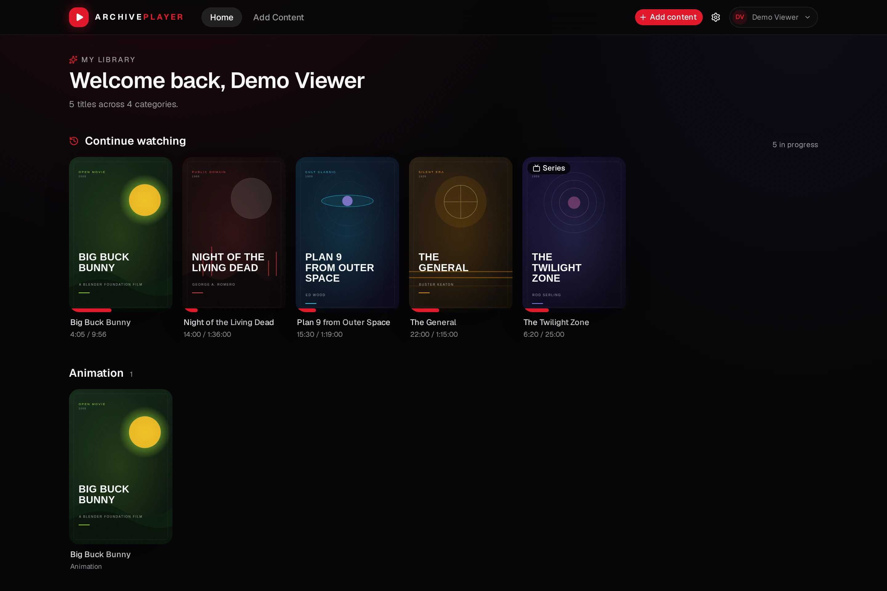
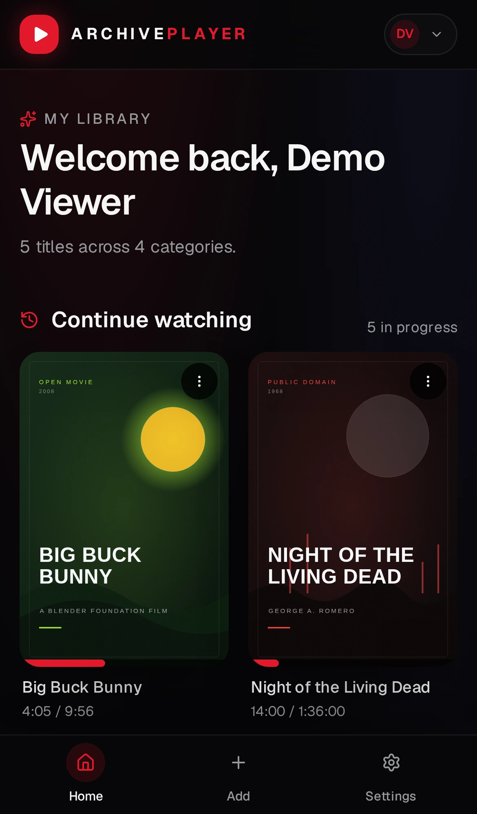
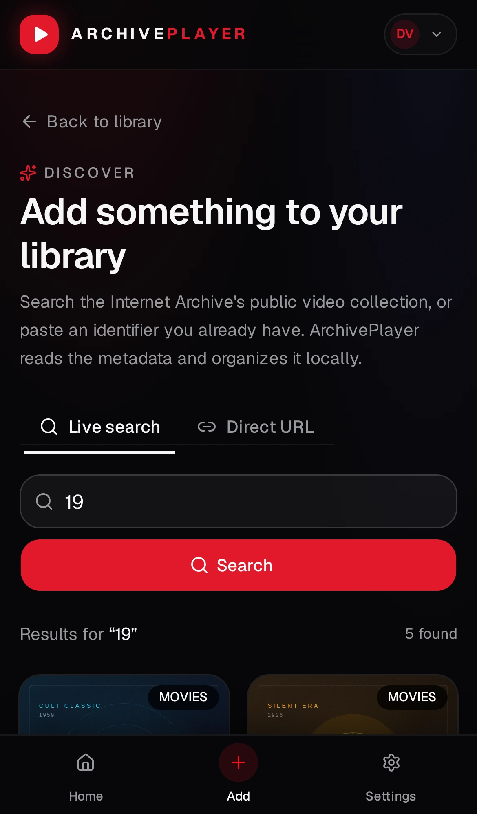
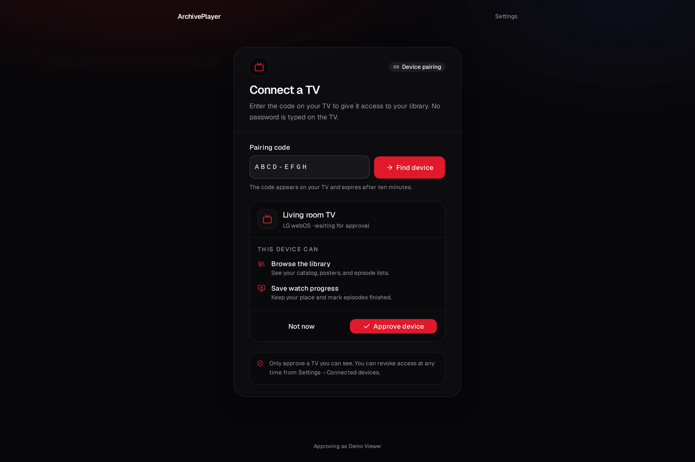

# ArchivePlayer

<p>
  <a href="https://github.com/LovelessCodes/ArchivePlayer/actions/workflows/ci.yml"></a>
  <a href="https://github.com/LovelessCodes/ArchivePlayer/actions/workflows/release.yml"></a>
  <a href="https://github.com/LovelessCodes/ArchivePlayer/actions/workflows/docker.yml"></a>
</p>

A local-first media library for public-domain films and shows from
[Archive.org](https://archive.org). Browse and search the Internet Archive, build
your own shelves, and stream directly from their servers — while your catalog and
watch history stay on your machine.

ArchivePlayer runs in two shapes from the same Rust core:

- **Desktop** — a native Tauri app for Windows, macOS, and Linux.
- **Self-hosted** — a small Axum web server and Docker image. Put it on a home
  server, NAS, or VPS and reach your library from any browser on your network.
  The web build is also an installable PWA.

This is a ground-up **Rust** rewrite of
[ArchivePlayer by Jeppe Kjeldal](https://github.com/JeppeKjeldal/ArchivePlayer),
which was originally an ASP.NET Core MVC application. The desktop and server
runtimes share the same domain crate. Prebuilt desktop installers are available
on the [Releases](https://github.com/LovelessCodes/ArchivePlayer/releases) page.

> **Attribution:** This project is derived from
> [JeppeKjeldal/ArchivePlayer](https://github.com/JeppeKjeldal/ArchivePlayer).
> The original author is credited in the app's Settings → About screen and in the
> [LICENSE](LICENSE) file. The concept, feature set, and product design are based
> on that project.



<p align="center">
  
  
</p>

<p align="center"><sub>Screenshots use the built-in browser demo and local sample posters.</sub></p>

## Features

- **Live Archive.org search** with video filtering and pagination.
- **Add by URL or identifier** for items you already know.
- **Custom categories** for organizing your library, with TMDB-powered suggestions.
- **Continue watching** with per-title and per-episode progress.
- **Episode selector** with season filtering and automatic next-episode playback.
- **Playback controls**: speed, picture-in-picture, fullscreen, 10-second skip,
  mute, keyboard shortcuts, and double-tap/double-click seeking.
- **Optional TMDB enrichment**: posters, genres, episode titles, descriptions, and
  category suggestions.
- **Filename-based episode detection** when TMDB is not configured.
- **Profiles** with Argon2 password hashing. Desktop keeps the session in memory;
  server mode uses random, hashed session cookies.
- **TV and native client pairing** with a ten-minute device code, explicit
  per-device permissions, and revocable bearer tokens.
- **SQLite catalog** — no account service, telemetry, or cloud dependency. Keep it
  desktop-only, or run the server and share it with your devices.
- **Clear watch history** or remove individual titles at any time.
- A dark, responsive UI built with React 19, Tailwind CSS v4, and shadcn/ui
  components on [Base UI](https://base-ui.com/).
- **Installable PWA** with an offline app shell, safe-area-aware mobile layout,
  touch-friendly controls, and a bottom navigation bar.

## Tech stack

| Layer | Technology |
| --- | --- |
| Desktop shell | Tauri 2 |
| Web server | Axum + Tokio |
| Backend | Rust 2024 edition, one shared `archiveplayer-core` crate |
| Frontend | React 19, TypeScript, Vite |
| Styling | Tailwind CSS v4, shadcn/ui (Base UI primitives) |
| Data fetching | TanStack Query |
| Database | SQLite via `rusqlite` (bundled) |
| Passwords | Argon2id |
| HTTP | `reqwest` with rustls |
| Metadata | Archive.org, optional TMDB v3 API |
| Packaging | Tauri bundles, Docker / GHCR multi-arch image |

## Getting started

### Prerequisites

- [Rust](https://rustup.rs/) 1.90 or newer
- Node.js 22 or newer and [pnpm](https://pnpm.io/)
- Tauri system dependencies for your platform. On Debian/Ubuntu:

  ```bash
  sudo apt install libwebkit2gtk-4.1-dev libgtk-3-dev libayatana-appindicator3-dev \
    librsvg2-dev libsoup-3.0-dev build-essential curl wget file
  ```

  See the [Tauri prerequisites guide](https://tauri.app/start/prerequisites/)
  for macOS and Windows.

### Run the desktop app

```bash
pnpm install
pnpm tauri dev
```

The first Rust build takes a while. Tauri starts Vite automatically.

### Run the self-hosted server

Build the frontend once, then start the Axum server:

```bash
pnpm install
pnpm build
cargo run -p archiveplayer-server --release
```

Open `http://localhost:8080`. The first account you create is the **server owner**;
after that, registration is closed unless you explicitly enable it. The server
serves the built `dist/` directory and stores SQLite, `settings.json`, and a
stable `server-id` in `ARCHIVEPLAYER_DATA_DIR` (default `./data`).

#### Docker

```bash
docker compose up -d --build
```

`compose.yaml` binds to `127.0.0.1:8080` and keeps data in the named volume
`archiveplayer-data`. Open `http://localhost:8080` on the host. The container is
multi-arch (`linux/amd64`, `linux/arm64`); published images are available at
`ghcr.io/lovelesscodes/archiveplayer`.

To reach it from other devices, put a TLS reverse proxy (Caddy, nginx, Traefik)
in front of it and change the port mapping to `"8080:8080"` only on a trusted
network. Set `ARCHIVEPLAYER_SECURE_COOKIES=true` when the public URL is HTTPS,
and `ARCHIVEPLAYER_TRUST_PROXY=true` when the proxy sets forwarding headers.
Docker bridge networking does not forward mDNS, so keep
`ARCHIVEPLAYER_MDNS=false` unless the container uses host networking.

#### Install it as an app

When the server is served over HTTPS (or `localhost`), open it in a browser and
use **Install app** / **Add to Home Screen**. On iOS, use Share → Add to Home
Screen. The installed app gets its own window and caches the application shell,
so it opens instantly and shows a branded offline page without a connection.
The catalog and Archive.org streams still need the server and the network; they
are deliberately never cached. Settings → **Install as an app** offers the
browser prompt where available and shows the right instructions elsewhere.

Service workers require a secure context. A server reached over plain HTTP at a
LAN address will work in the browser but cannot be installed as a PWA; put it
behind TLS first.

#### Pair a TV or native client

The server implements an OAuth-style device authorization flow, so a TV never
asks for your password. Open **Settings → Connected devices** in a signed-in
browser, then enter the eight-character code shown on the TV. The activation page
is at `/#/activate`; a QR code can point directly to
`/#/activate?code=ABCD-EFGH`.

Each paired device receives an opaque bearer token with explicit scopes
(`library:read`, `library:write`, `progress:write`) and can be revoked instantly.
Tokens are stored only as SHA-256 hashes. See
[docs/tv-clients.md](docs/tv-clients.md) for the endpoint contract and client
notes; pair over HTTPS before exposing the server outside your network.



#### Discover the server on a LAN

When the server binds to a LAN address, it advertises itself over mDNS/DNS-SD:

```text
_archiveplayer._tcp.local
```

The TXT record includes the friendly name, a stable server ID, the API version,
a preferred LAN `addr`, and `ARCHIVEPLAYER_PUBLIC_URL` when configured. A TV can
list nearby servers and connect with one tap instead of asking for an IP address.

mDNS is best-effort and optional. It is skipped when the server binds to
`127.0.0.1`, and Docker's default bridge network does not forward multicast to
the LAN. For Docker discovery, use `network_mode: host` on Linux or advertise
from the host with Avahi; otherwise leave `ARCHIVEPLAYER_MDNS=false` and enter
the server address once. Set `ARCHIVEPLAYER_SERVER_NAME` to control the name
shown on the TV.

#### Reach the server while travelling

Keep `ARCHIVEPLAYER_PUBLIC_URL` pointed at a stable HTTPS address and pair the
TV while it can reach the server. A client can store both the discovered LAN
address and the public URL, then fall back to the public URL when away from
home.

Do not expose port 8080 directly. Put Caddy, nginx, or Traefik in front of it,
or use Tailscale, WireGuard, or Cloudflare Tunnel. When a reverse proxy supplies
`X-Forwarded-For` / `X-Forwarded-Proto`, set `ARCHIVEPLAYER_TRUST_PROXY=true` so
rate limiting uses the real client address and pairing links use the right
scheme.

| Variable | Default | Purpose |
| --- | --- | --- |
| `ARCHIVEPLAYER_BIND` | `127.0.0.1:8080` (Docker: `0.0.0.0:8080`) | Listen address. |
| `ARCHIVEPLAYER_DATA_DIR` | `data` (`/data` in Docker) | SQLite database, settings, and the stable discovery ID. |
| `ARCHIVEPLAYER_STATIC_DIR` | `dist` (`/app/dist` in Docker) | Built frontend files. |
| `ARCHIVEPLAYER_ALLOW_REGISTRATION` | `false` | Allow anyone to create an account after the owner. |
| `ARCHIVEPLAYER_SECURE_COOKIES` | `false` | Mark session cookies `Secure`; enable behind HTTPS. |
| `ARCHIVEPLAYER_SESSION_DAYS` | `30` | Browser session lifetime, clamped to 1–365 days. |
| `ARCHIVEPLAYER_DEVICE_SESSION_DAYS` | `180` | Paired-device token lifetime, clamped to 1–3650 days. |
| `ARCHIVEPLAYER_PUBLIC_URL` | unset | Public base URL used in pairing links and mDNS TXT records, e.g. `https://media.example.com`. |
| `ARCHIVEPLAYER_CORS_ORIGINS` | unset | Comma-separated browser origins allowed to call the API (webOS/TV wrappers). Native apps do not need it. |
| `ARCHIVEPLAYER_MDNS` | `true` | Advertise `_archiveplayer._tcp.local` on the LAN when not bound to loopback. |
| `ARCHIVEPLAYER_SERVER_NAME` | hostname | Friendly name shown by LAN discovery. |
| `ARCHIVEPLAYER_TRUST_PROXY` | `false` | Trust `X-Forwarded-For` / `X-Forwarded-Proto` from a reverse proxy. |
| `ARCHIVEPLAYER_RATE_LIMIT_PER_MINUTE` | `240` | General API requests per minute per client IP; `0` disables. |
| `ARCHIVEPLAYER_AUTH_RATE_LIMIT_PER_MINUTE` | `10` | Login and registration requests per minute per client IP; `0` disables. |
| `ARCHIVEPLAYER_DEVICE_RATE_LIMIT_PER_MINUTE` | `60` | Device pairing requests per minute per client IP; `0` disables. |

Back up the volume before upgrades:

```bash
docker run --rm -v archiveplayer-data:/data -v "$PWD":/backup \
  debian:bookworm-slim tar czf /backup/archiveplayer-data.tgz -C /data .
```

### Run the UI in a browser (mock backend)

`pnpm dev` opens the React app at `http://localhost:1420` with a small
in-memory/localStorage mock backend. This is useful for frontend work without
compiling Rust:

```bash
pnpm dev
```

The browser demo seeds a sample library after you create a local profile. It is
only available in Vite development mode; the desktop app and the server build
always use the real Rust backend.

To point the Vite dev server at a running ArchivePlayer server instead, set
`VITE_USE_MOCK=false`. `/api` is proxied to `http://127.0.0.1:8080` by default;
set `ARCHIVEPLAYER_API` to use another address.

### Checks and tests

```bash
pnpm check                 # TypeScript type check
pnpm build                 # production frontend build
cargo test --workspace     # Rust unit tests
cargo clippy --workspace --all-targets
```

Regenerate the committed README screenshots (browser mock backend):

```bash
pnpm exec playwright install chromium
pnpm screenshots
```

Screenshots are written to `docs/screenshots/` as WebP. The mock backend uses
local demo posters from `public/demo/`, so generation does not depend on
Archive.org. Set `SCREENSHOT_BASE_URL` to reuse a running Vite dev server.

### Build installers

```bash
pnpm tauri build
```

Bundles are written to `target/release/bundle/`. Use
`pnpm tauri build --no-bundle` to produce just the binary. The standalone server
binary is built with `cargo build --release -p archiveplayer-server`.

### Releases

Releases are built by GitHub Actions when a version tag is pushed:

```bash
git tag v0.5.0
git push origin v0.5.0
```

The tag must match the version in `package.json`, `src-tauri/tauri.conf.json`,
`Cargo.toml`, and `src-tauri/Cargo.toml`; the workflow fails early if they differ.
It builds and attaches:

- **Windows x64** — NSIS `.exe` and `.msi`
- **macOS Intel** (`x86_64`) — `.dmg`
- **macOS Apple Silicon** (`aarch64`) — `.dmg`
- **Linux x64** — `.deb` and `.AppImage`
- **Linux ARM64** (`aarch64`) — `.deb`

The installers are currently **unsigned**. macOS may require right-click → **Open**
the first time, and Windows SmartScreen may warn. Linux AppImage users may need
to run `chmod +x` before launching.

The `Docker image` workflow builds and pushes the multi-arch server image to GHCR
on the same tag. Package visibility must be set to public once in the GitHub
package settings if you want anonymous pulls.

### Server data and sessions

In server mode the same SQLite catalog is stored in `ARCHIVEPLAYER_DATA_DIR`:

- `archiveplayer.db` — profiles, library, categories, watch history, sessions.
- `server-id` — stable discovery identity used by mDNS clients (written with
  `0600` on Unix).
- `settings.json` — last-used email and optional TMDB key (written with `0600`
  permissions on Unix).

The first registered account is the owner and the only account that can change
the TMDB key. Browser sessions are random 32-byte tokens stored only as SHA-256
hashes, sent in an `HttpOnly`, `SameSite=Lax` cookie. Paired devices use the same
session table with an opaque `Authorization: Bearer ...` token, a label, a
platform, scopes, and a longer lifetime. Approval codes and device tokens are
both stored hashed; expired sessions and pairing requests are cleaned up when
someone signs in, registers, or starts a new pairing.

## How it works

```text
┌──────────────────────────────┐   ┌──────────────────────────────┐
│ Tauri window                 │   │ Browser                      │
│  React 19 + Tailwind         │   │  React 19 + Tailwind         │
│    ↕ typed invoke() calls    │   │    ↕ HTTP /api/*             │
│  src-tauri commands          │   │  archiveplayer-server (Axum) │
└──────────────┬───────────────┘   └──────────────┬───────────────┘
               └───────────────┬──────────────────┘
                               ▼
                 crates/archiveplayer-core
   auth · sessions · settings · SQLite · Archive.org · TMDB · playback
```

- `src/` — React app, routes, feature pages, UI components, browser mock.
- `src-tauri/` — Tauri entry point, commands, capabilities, and packaging config.
- `crates/archiveplayer-server/` — Axum HTTP API, cookie sessions, static file
  serving, CSP/security headers, and Docker runtime.
- `crates/archiveplayer-core/` — framework-independent Rust domain logic shared by
  both runtimes:
  - `db.rs` + `migrations/` — users, library, categories, progress.
  - `archive.rs` — Archive.org advanced search and metadata.
  - `tmdb.rs` — optional TMDB matching, posters, and episodes.
  - `episodes.rs` — filename-based episode detection and matching.
  - `service.rs` — orchestration used by both the Tauri commands and HTTP routes.

### Local data (desktop)

The desktop app stores its database and settings in the Tauri application data
directory:

- **Linux:** `~/.local/share/io.github.jeppekjeldal.archiveplayer/`
- **macOS:** `~/Library/Application Support/io.github.jeppekjeldal.archiveplayer/`
- **Windows:** `%APPDATA%\io.github.jeppekjeldal.archiveplayer\`

Files:

- `archiveplayer.db` — profiles, library, categories, watch history.
- `settings.json` — last email and optional TMDB key (written with `0600`
  permissions on Unix).

Set `ARCHIVEPLAYER_DATA_DIR` to override the location (useful for portable setups
or testing). The self-hosted server uses the same files under
`ARCHIVEPLAYER_DATA_DIR` instead.

### Profiles and sessions

On desktop the session is held in memory, so closing the app signs you out; the
library is preserved. On the server, the session is a hashed token in SQLite and
the browser holds an `HttpOnly` cookie, so you stay signed in across restarts
until the session expires or you sign out. Passwords are hashed with
Argon2id; no plaintext password is stored.

Each profile has its own library, categories, and watch history. Profiles do not
share items with each other.

### TMDB (optional)

ArchivePlayer works without any API key. To enable richer metadata:

1. Create a free account at [themoviedb.org](https://www.themoviedb.org/signup).
2. Request a v3 API key under **Settings → API**.
3. Paste it into **Settings → TMDB metadata** in ArchivePlayer, then use
   **Test connection**.

The key is stored only in `settings.json` and is sent only to
`api.themoviedb.org`. On the server, only the owner can view or change it; other
profiles never receive the key. Without a key, ArchivePlayer uses Archive.org
thumbnails and filename-based episode parsing.

## Playback and privacy

- Video is streamed from Archive.org; nothing is downloaded to your library
  folder. Availability and playback depend on Archive.org and the codecs
  supported by the system webview (WebKitGTK on Linux, WKWebView on macOS,
  WebView2 on Windows).
- Network access is limited to Archive.org, TMDB (only with a key), and the
  external links you explicitly open.
- There is no analytics, telemetry, or remote account system.
- The self-hosted server has no built-in TLS. Run it behind a TLS reverse proxy
  before exposing it outside your network, and enable `ARCHIVEPLAYER_SECURE_COOKIES`.
- ArchivePlayer is not affiliated with the Internet Archive or TMDB.

## Known limitations

- Playback of every Archive.org format is not guaranteed; `.mp4`, `.webm`, and
  formats supported by the platform webview are the most reliable. The app
  prefers `.mp4` files when an item has several video formats.
- Episode matching is heuristic when TMDB is not configured or cannot find a
  match.
- Desktop keeps a single-machine library. The server shares one install across
  devices, but profiles remain separate and there is no third-party sync.
- Archive.org items can be removed or restricted by their uploaders at any time.

## License and attribution

Released under the [MIT License with Attribution Requirement](LICENSE).

This project is a derivative rewrite of
[ArchivePlayer](https://github.com/JeppeKjeldal/ArchivePlayer) by
**Jeppe Kjeldal**. The original project's attribution request is preserved here,
in the application's About screen, and in the repository history:

- Credit the original author: **Jeppe Kjeldal**.
- Link to the original repository:
  <https://github.com/JeppeKjeldal/ArchivePlayer>.
- Note that this work is derived from that project.

See [LICENSE](LICENSE) for the full text.
